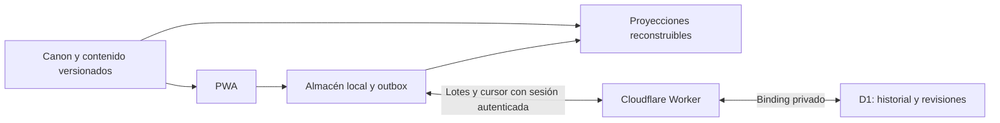

# Propuesta de arquitectura

Estado: diseño para aprobación. No se elige ni instala un stack definitivo.

## Hechos, inferencias y recomendación

Hechos: el repositorio contiene el Research Pack y propuestas documentales; no hay aplicación ni patrones técnicos existentes que reutilizar. El uso inicial será móvil y el idioma inicial italiano. La investigación no fija fórmula de dominio, scheduler ni tecnología.

Inferencia: el recorrido A1 completo con contenido revisado, evaluación por alcance y composición con abstención puede funcionar localmente sin IA en ejecución; falta medir volumen editorial y rendimiento real. Decisión de Sergio: PWA local-first → almacenamiento local offline → Cloudflare Worker → Cloudflare D1. Se sincroniza el historial entre dispositivos; el backup manual es secundario. Recomendación: frontend y API bajo el mismo origen para simplificar autenticación, con contenido estático y acceso D1 exclusivo del Worker.

## Límites de responsabilidad

| Módulo conceptual | Entrada → salida y límite |
|---|---|
| Interfaz | Acciones y borradores → comandos de sesión; presenta evidencia, no calcula dominio. |
| Learning Engine | Objetivo + perfil + catálogo → siguiente paso explicado. Coordina; no contiene gramática italiana. |
| Exercise Engine | Definición versionada → actividad, apoyos y evaluación por oportunidad. Cada familia ofrece presentación y contrato de evaluación. |
| Evaluación lingüística | Respuesta + criterios publicados del pack → correcto/error/no evaluable/sin oportunidad. No inventa reglas ni fuerza coincidencia literal universal. |
| Evidence / Mastery | Intentos y evaluación → perfil explicable bajo política versionada. No modifica intentos. |
| Review Scheduler | Evidencia + fecha + presupuesto → necesidades y prioridades, con razones. No decide corrección. |
| Content Repository | Catálogo aprobado → unidades y variantes compatibles. Candidatos no publicados quedan fuera de sesiones evaluadas. |
| Persistencia/sincronización | Guarda hechos y outbox localmente, sincroniza con Worker/D1, importa por cursor y reconstruye proyecciones; exporta/importa respaldo. |

No se proponen microservicios, base de grafos, embeddings, colas ni un framework de plugins. Las extensiones son contratos internos y datos de idioma. Un nuevo tipo de ejercicio añade su presentación y evaluación manteniendo el formato de evidencia; una nueva lengua añade su pack y las reglas lingüísticas que precise.

## Contrato del ejercicio

Cada actividad declara ID/versión, familia, consigna, habilidad objetivo, formato, oportunidades, conceptos incidentales, apoyos, vocabulario, contexto, facetas, familia de variantes y criterio de aceptación. La evaluación devuelve juicios por oportunidad y feedback enlazado al canon. No asigna directamente mastery.

Siete familias propuestas tras contrastar Research 03: F1 selección significativa; F2 recuperación/huecos/cloze; F3 transformación y reparación; F4 construcción situada y diálogo; F5 lectura con tareas; F6 composición guiada y autónoma; F7 asociación y ordenación accesible. F7 conserva subtipos distintos (emparejar relaciones y ordenar secuencias), sin atribuirles evidencia idéntica. F6 incorpora composición sostenida y revisión del texto sin fragmentarla en respuestas cerradas; F7 permite trabajar referencias, secuencias e integración con apoyo en móvil. No se añaden únicamente por variedad visual. [CONTENT_STRATEGY](../product/CONTENT_STRATEGY.md) mapea toda la taxonomía a estas familias.

Conjugación es recuperación de forma; detección es selección; reparación es transformación; traducción puede pedir comprensión o construcción y lo declara. F5/F6 pueden componer interacciones reutilizadas F1–F4/F7 sin crear motores distintos. Escritura autónoma está en V1; corrección universal de lenguaje abierto no se promete. Oportunidades indeterminadas no generan evidencia y se ofrece comprobación focal fiable del mismo objetivo.

Validación cerrada por respuestas/variantes y reglas revisadas del alcance. Normalizar espacios y formas tipográficas cuando no alteran el objetivo; nunca borrar distinciones como e/è o apóstrofos de manera global. Respuesta fuera del conjunto conocido no implica error: el evaluador debe poder abstenerse. No se promete análisis gramatical general mediante expresiones regulares.

## Selección focal, mezcla y recomendación

1. Filtrar contenido publicado, compatible, accesible y con oportunidad para el objetivo.
2. En Focus, atender al alcance elegido y comprobar antes de ayudar. En Mixed/Review, construir candidatos por error observado, revisión diferida, laguna de evidencia y concepto reciente.
3. Priorizar obstáculos recurrentes pertinentes y comprobaciones pendientes; asegurar que también se visitan necesidades antiguas, sin que un patrón absorba siempre toda la sesión.
4. Preferir facetas y familias de ítems menos vistas; alternar demandas sin introducir léxico o estructuras desconocidas por accidente.
5. Reservar la siguiente tarea solo cuando haya presupuesto razonable; permitir terminar con resumen parcial. Si falta contenido, explicarlo y no presentar repetición como transferencia nueva.

No hay porcentajes fijos. Desempates y reglas deben ser reproducibles y guardar razón de selección. La recomendación de aprender algo nuevo considera función deseada y preparación; no exige dominio total de prerrequisitos.

## Mastery y scheduler iniciales

Propuesta de reglas explicables por dimensión, sin puntuación compuesta. Una selección asistida solo informa comprensión/reconocimiento asistido. Recuperación independiente requiere intento anterior a modelo/pista determinante. Uso en mezcla requiere elección real entre alternativas conocidas. Estabilidad requiere oportunidades independientes, diversas y separadas por tiempo real desde exposición relevante.

Se parametrizan después, antes del piloto: mínimo de oportunidades/facetas, distancia temporal, criterio de recurrencia, tolerancia a lapsos y revisión de estabilidad. Se guardará versión de política. No se publicará «estable» mientras no exista una política de evidencia aprobada y verificable; durante un piloto inicial puede mostrarse simplemente el historial observado.

Scheduler: proponer comprobación posterior para aprendizajes recientes; espaciar tras evidencia independiente variada; acercar tras dificultad confirmada. Retomar tras ausencia con una muestra priorizada. Reparación inmediata y comprobación diferida son necesidades distintas; completar una no satisface automáticamente la otra. Intervalos concretos son H pendiente de calibración.

## Canon y generación

Canon versionado con fuente lingüística, alcance y revisión; actividades publicadas referencian esa versión. Origen humano o generado permanece en procedencia. Flujo editorial: candidato → revisión lingüística y pedagógica independiente → publicado / retenido / retirado. Una IA no se valida a sí misma como única autoridad.

V1: canon y contenido publicados revisados, con variantes deterministas restringidas. Generación offline durante desarrollo puede ayudar a producir candidatos, con revisión antes de publicar y sin coste autorizado implícito. No se requiere generación ni corrección de IA durante el uso normal. Ninguna salida generada tiene permiso para reescribir reglas o criterios. Reportes de ambigüedad suspenden el juicio discutido y conservan el intento. En V1, «Creo que mi respuesta es válida» crea una incidencia local sincronizable y exportable, excluye esa observación de inferencias y evita reutilizar el ítem cuestionado para evaluar a ese perfil. Sincronizar la incidencia no envía mensajes a un revisor ni promete revisión remota. El usuario puede continuar con otra actividad; retirar su incidencia no convierte la respuesta en correcta. Una revisión editorial posterior puede publicar criterio corregido/versionado o mantener abstención; resolver el caso requiere revaluación explícita trazable. Los reportes no bloquean otros objetivos ni generan crédito positivo.

## Patrón de healt-tracker inspeccionado y reutilización

Architecture revisó estáticamente el proyecto local `healt-tracker`; no lo modificó ni ejecutó sus tests. Rutas relativas a ese repositorio:

| Evidencia de código | Qué conservar/adaptar |
|---|---|
| `src/data/repository.mjs:21,65` | IndexedDB, migraciones e índices, escrituras relacionadas en transacción; adaptar a hechos/outbox/cursor. |
| `backend/worker.mjs:66,101` | Binding D1, SQL parametrizado, revisión condicional y límites reales de payload; ampliar validación por tipo/esquema/versiones. |
| `sw.js:18` | Caché del shell mediante lista permitida; excluir API autenticada y coordinar actualización con sesiones activas. |
| `src/main.mjs:1094` | Disparadores al volver/foco/visibilidad y control de solicitudes simultáneas; añadir outbox y no copiar polling del Atajo. |

No copiar el protocolo de snapshot: `src/data/remote-repository.mjs:40,79` sustituye estado local por remoto y consulta red antes de mutar; ante conflicto 409 vuelve a descargar para reaplicar el cambio. `src/main.mjs:969` condiciona arranque a conectar el backend. `backend/migrations/0001_health_state.sql` guarda una fila JSON global con revisión. Eso no satisface historial incremental, offline durable y conflictos sin pérdida exigidos aquí.

Tampoco trasladar el Bearer persistido en localStorage (`remote-repository.mjs:3`, `main.mjs:936`) ni usar ausencia de cabecera CORS como rechazo de una mutación (`worker.mjs:23,36`). La nueva autenticación por cookie necesita validación explícita de origen/CSRF. El origen separado GitHub Pages→Worker del proyecto existente no se adopta suponiendo equivalencia con cookies: desplegar PWA/API bajo un mismo origen real es parte de la propuesta. No se reutilizan base, token ni datos de salud.

Se reutilizan técnicas y organización; no hay copia de código ni migración de datos en esta fase. Las pruebas existentes de snapshots no acreditan el protocolo nuevo.

## Persistencia local-first, sincronización y recuperación

La fuente durable compartida son los hechos confirmados en D1; cada dispositivo añade hechos offline en su almacén local y conserva una outbox hasta confirmación remota. La UI utiliza datos locales para responder sin red. No se sustituye todo el estado con un JSON remoto. Historial original, versiones y correcciones se conservan; MasteryProfile, ReviewNeed y ErrorPattern son vistas reconstruibles.

Persistir sesiones y revisiones de estado/borrador, Exposure incluso desde Biblioteca, Attempt, Evaluation/Opportunity, Evidence, ErrorEvent, incidencias, invalidaciones y versiones de política/contenido/evaluador. Evaluaciones y evidencias originales son interpretaciones observadas con procedencia: se conservan tal como se produjeron, sin declararlas verdad inmutable. Una reevaluación genera otra versión que referencia a la anterior; el perfil usa la revisión vigente y no suma ambas.

Protocolo conceptual:

1. Guardar hechos relacionados y operación de salida en una transacción local antes de confirmar «guardado». IDs globales aleatorios, device ID y secuencia local; el envío doble de una misma acción reutiliza ID.
2. Al abrir/volver a la app, recuperar conexión, guardar o pulsar sincronizar, enviar lotes acotados pendientes. Backoff con variación y reintentos; no depender de que el sistema operativo ejecute trabajo con la PWA cerrada.
3. Worker autentica, deriva owner ID de la sesión (no del cuerpo), valida esquema, tamaño, referencias, versiones y operación. D1 aplica un grupo dependiente atómicamente; cada lote tiene recibo y cada hecho una clave única por propietario/ID.
4. Mismo ID y contenido equivalente: ACK idempotente, sin volver a insertar. Mismo ID con contenido distinto: conflicto explícito, no sobrescritura. ACK solo después de persistencia; si se pierde, reenviar es seguro. Un lote inválido se conserva y se aísla del resto para no bloquear indefinidamente toda la cola.
5. Descargar hechos/revisiones posteriores a un cursor monotónico de servidor, paginados. Aplicarlos y avanzar cursor en la misma transacción local. Nunca usar el reloj del teléfono como cursor. El orden de llegada no se usa como fecha de aprendizaje.
6. Reconstruir incrementalmente proyecciones para Concepts afectados. Cambio de política permite reconstrucción completa por lotes usando historial y versiones. No sumar snapshots de dominio provenientes de dos dispositivos.

Conexión restablecida sincroniza cuando la app puede ejecutarse; una PWA cerrada puede necesitar reabrirse. El nuevo dispositivo se autentica como el mismo propietario, descarga historial paginado y versiones requeridas, conserva cualquier trabajo local pendiente y reconstruye perfil. No mostrar historial vacío como progreso realmente nulo durante bootstrap. Si faltan versiones, mostrar reconstrucción pendiente en vez de inventar datos.

### Conflictos entre dispositivos

| Dato/caso | Política propuesta |
|---|---|
| Intentos independientes offline | Unión de hechos por ID; conservar ambos. No contar dos respuestas al mismo ítem como dos pruebas nuevas independientes. |
| Misma acción reenviada | Idempotencia por ID/recibo; no duplicación de evidencia. |
| Sesión continuada en dos dispositivos | Ramas de continuación con referencias al mismo origen; no borrar intentos de ninguna. Resolver qué continuar sin fusionar secuencias incompatibles. |
| Borrador editado simultáneamente | Revisiones con baseRevision; conflicto guarda ambas versiones y pide elegir/copiar, nunca last-write-wins silencioso del texto. |
| Preferencias no pedagógicas | Actualización condicional por revisión; si hay conflicto mostrar el valor remoto y permitir reaplicar. |
| Evaluación/invalidación concurrente | Mantener revisiones y enlaces; política versionada determina vigencia, sin sumar juicios duplicados. |
| Relojes distintos o eventos tardíos | Conservar occurredAt, receivedAt y secuencia causal por dispositivo; si separación temporal no es fiable, abstenerse de afirmar estabilidad diferida. |
| Cliente/schema obsoleto | Retener outbox, explicar actualización requerida; no descartar hechos ni aceptar reinterpretación silenciosa. |

Exposición vista en otro dispositivo que llega tarde puede cambiar la independencia atribuida a una respuesta: recalcular, no preservar un dominio falso por haber sincronizado antes. No se necesita CRDT general para todos los objetos; hechos aditivos + revisiones condicionales y conservación de borradores bastan como propuesta inicial.

### Identidad y seguridad sencillas

Propuesta para un único propietario: código de acceso/recuperación aleatorio de alta entropía guardado por Sergio en su gestor de contraseñas. Cada dispositivo lo introduce una vez por HTTPS para obtener una sesión revocable propia. Worker verifica su derivado secreto y asocia siempre el mismo owner ID interno; no registro público, perfiles sociales, correo transaccional ni sistema de roles.

La clave de recuperación se provisiona fuera del código público y su verificador queda en un secreto del Worker; no es un token de Cloudflare ni una credencial D1. Se usa transitoriamente en el formulario y no se persiste en IndexedDB, exportaciones, URL, logs ni bundle. El servidor guarda solo hash de tokens de sesión opacos; el navegador recibe cookie Secure, HttpOnly y SameSite bajo mismo origen, con vencimiento y revocación por dispositivo. Validar Origin/CSRF en mutaciones y limitar solicitudes de acceso. No reutilizar token ni base del proyecto de salud.

El binding D1 existe solo en Worker. No hay endpoint SQL genérico ni confianza en owner ID arbitrario; consultas parametrizadas y límites de payload. Caché del service worker guarda contenido público y datos locales gestionados, no respuestas autenticadas de API ni credenciales. Una API privada responde sin caché compartida. La clave maestra se rota administrativamente preservando owner ID; si se pierde, recuperar acceso requiere al propietario de Cloudflare, sin borrar historial. Conocer esa clave permite acceder al progreso: no se ofrece como código público compartible.

Expiración/revocación suspende sincronización, conserva outbox e identidad local y no reprovisiona un owner distinto al reautenticar; no borra trabajo. El estudio offline ya asociado al propietario continúa en su dispositivo; el bloqueo/borrado local es una acción aparte, pues no se promete revocación remota de copias sin conexión. V1 no ofrece cambiar de usuario: un identificador inesperado detiene la vinculación y mantiene separado el espacio local. Ampliar a varios usuarios exigiría diseño específico posterior.

### Backup, importación y reconstrucción

Exportación/importación manual versionada se conserva para portabilidad y recuperación excepcional. No es sincronización primaria. Validar esquema, owner y versiones; previsualizar y respaldar antes de incorporar. Importar une hechos por IDs originales, conserva procedencia y deduplica; no reemplaza D1 con un snapshot antiguo ni resucita elementos invalidados. Archivos de otro propietario no se suben silenciosamente. Reconstruir proyecciones a partir del historial importado/sincronizado, no aceptar su puntuación como autoridad.

Revisiones/tombstones lógicos se sincronizan para evitar que un dispositivo antiguo o un backup restaure un estado invalidado. Un borrado irreversible del historial remoto, si se ofrece, exige confirmación y una nueva generación de datos para rechazar reenvíos de la generación eliminada; nunca se ejecuta como efecto de importar o desconectar.

Contenido y políticas publicados se distribuyen versionados y conservan artefactos necesarios para reproducir decisiones históricas. D1 guarda referencias exactas, hechos y metadatos; no necesita duplicar el banco editorial completo por usuario. Snapshots derivados pueden acelerar arranque si declaran política y cursor de hechos, pero siguen siendo descartables/reconstruibles.

## Coste y límites Cloudflare

Objetivo: plan gratuito, sin contratar ni activar pago. Documentación oficial consultada el 2026-10-06: D1 Free incluye 5 millones de filas leídas/día, 100.000 escritas/día y 5 GB totales por cuenta; los índices también consumen escrituras y al agotar cuota las consultas fallan. [Precios D1](https://developers.cloudflare.com/d1/platform/pricing/). El límite Free por base es 500 MB; no confundirlo con el total por cuenta. [Límites D1](https://developers.cloudflare.com/d1/platform/limits/). Workers Free admite 100.000 solicitudes/día. [Límites Workers](https://developers.cloudflare.com/workers/platform/limits/).

Estas cuotas pueden estar compartidas con healt-tracker en la cuenta; verificar consumo disponible antes de desplegar. Es razonable explorar uso personal en Free, pero no se garantiza coste cero indefinido sin medir historial, lecturas, índices y retención. Sin polling continuo: lotes, cursores, consultas indexadas y proyecciones incrementales. Si hay cuota agotada, mantener offline/outbox e informar; no descartar historial ni subir de plan automáticamente.

D1 permite batch transaccional y consultas preparadas; diseñar grupos acotados y comprobar límites antes de implementar. [API D1](https://developers.cloudflare.com/d1/worker-api/d1-database/). Mantener lecturas de sincronización coherentes con escritura; para V1 no se requiere replicación de lectura adicional. Ni el backup de plataforma ni la exportación sustituyen el historial persistido y la sincronización por hechos.

## Riesgos y validación de diseño

Mayor riesgo: cobertura editorial insuficiente o corrección demasiado estrecha que frustre al usuario. Mitigar con variantes explícitas, abstención y evaluación editorial antes de ampliar volumen. Otro riesgo: estados que parezcan científicos sin calibración; mostrar evidencia y límites.

La validación de esta fase es documental. Los contratos, casos de aceptación y trazabilidad se revisan ahora; pruebas de persistencia, accesibilidad, motor y recuperación corresponderán al desarrollo autorizado. No hay build ni tests de software aplicables todavía.

## Escalabilidad curricular y disponibilidad

La ampliación aumenta contenido y combinaciones, no exige sustituir las entidades ni introducir un servidor adicional al Worker previsto o una base de grafos. Índices por Concept, construcción, lexical set, fase, dimensión y estado permiten filtrar candidatos antes de ordenarlos. Guardar relaciones de adyacencia, requisitos declarados y proyecciones de evidencia; no materializar todo producto cartesiano de variantes ni recalcular todo el historial en cada respuesta.

Focus de un Topic resuelve sus subobjetivos, comprueba preparación y ofrece subalcance o grupo. Mezclar un grupo no acredita sus nodos no observados. Mixed cruza verbos, nominales, pronombres, preposiciones, tiempo y léxico solo cuando cada demanda es accesible o su apoyo está declarado. Review administra necesidades de cualquier Concept, prioriza por motivo/antigüedad de atención y distribuye oportunidades para evitar inanición, sin porcentajes permanentes. El tamaño de la cola no se presenta como deuda.

Publicación curricular y descarga local son estados diferentes. V1 contiene todo el A1 publicado; se pueden descargar recursos por paquete compatible y ofrecer descarga completa. Sin conexión, solo seleccionar ítems disponibles; la falta de descarga no se interpreta como bloqueo pedagógico ni elimina cobertura del producto. Manifiestos versionados identifican qué falta y permiten verificar integridad. Las actualizaciones no sustituyen actividades de sesiones activas por variantes incompatibles.

Validación posterior con el inventario completo, no solo essere: búsquedas por Topic, cola amplia de Review, mezclas entre áreas, restauración de historial y retirada de canon que afecta muchas variantes. Medir tiempos, memoria y volumen en móvil real; aún no hay benchmark ni necesidad demostrada de otra infraestructura. La sincronización Cloudflare ya forma parte de V1 por decisión de Sergio; se prueban también recuperación y conflictos entre dispositivos.

## Estrategia de entrega

Fases internas A–G en [V1_SCOPE](../mvp/V1_SCOPE.md). Una unidad editorial piloto y una integración vertical validan contratos antes de expandir; no son el producto final ni habilitan declarar V1 terminada. La puerta final exige toda la matriz curricular/editorial satisfecha con artefactos revisados y comportamiento funcional. Fallos de capacidad o autoría se resuelven dentro del alcance, sin enviar contenido A1 a POST-V1 silenciosamente.
